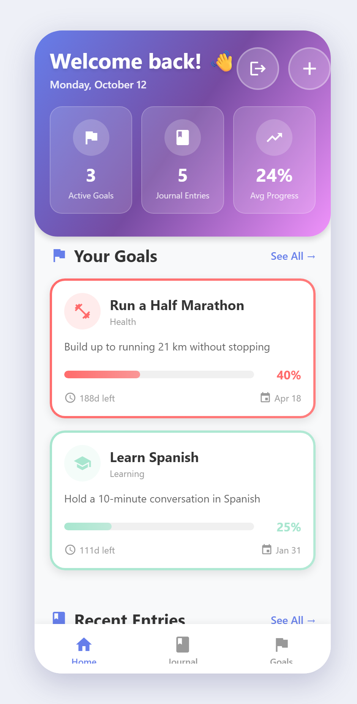
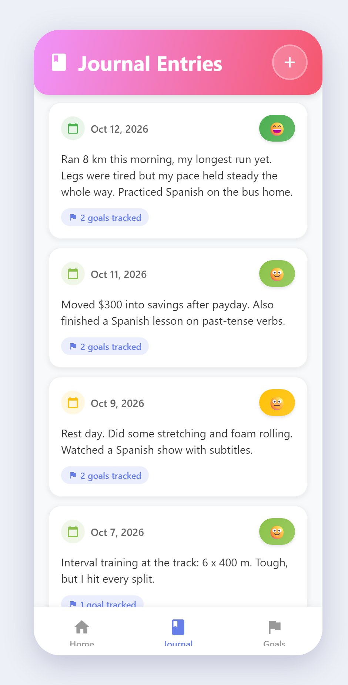
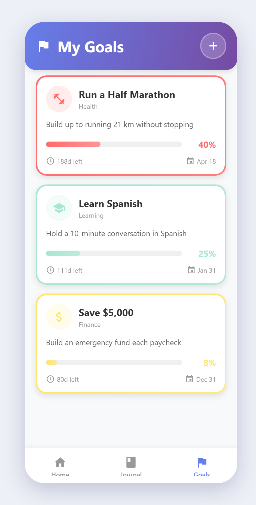
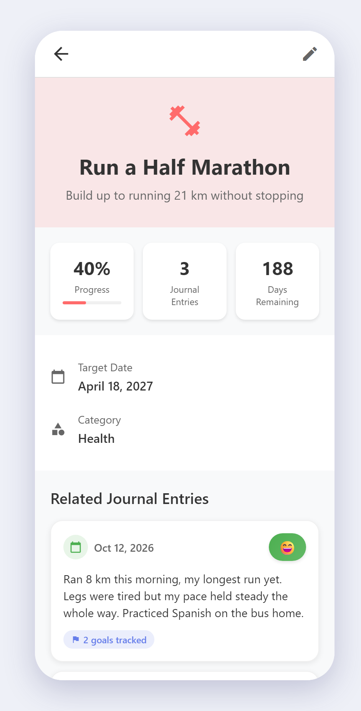
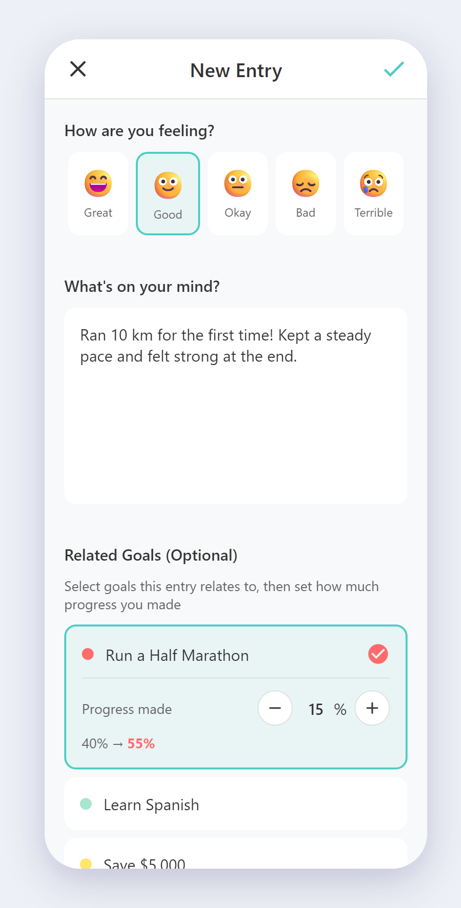
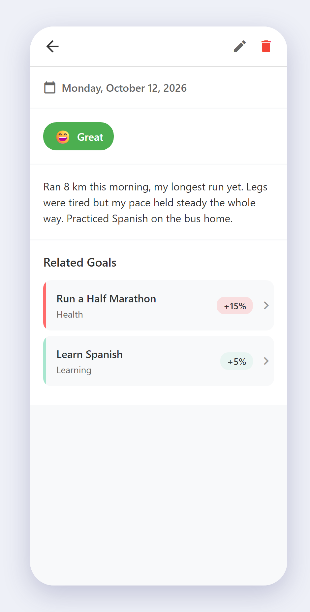
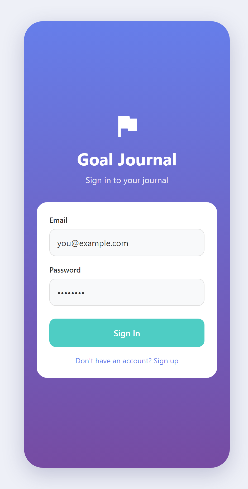

# Goal Journal

**Set goals, write about your days, and watch your progress grow.**

### 👉 [Open Goal Journal](https://goal-journal-app-two.vercel.app)

Goal Journal is a simple journal that connects what you write each day to the goals you care about. Each entry records how far it moved your goals forward, so you can see at a glance how close you are to running that race, learning that language, or hitting that savings target.

  
  
  

## Features

### 🏠 Your progress at a glance
The home screen shows how many goals you're working on, how many entries you've written, and your average progress across all goals, along with your top goals and most recent entries.

### 🎯 Goals that track themselves
Create a goal with a title, description, category (Health, Career, Personal, Finance, Learning, or Other), and an optional target date. Each goal shows a countdown to its target date and a progress bar that fills as you journal about it.

  

### 📝 Journal with your mood
Write about your day and pick how you're feeling, from 😄 Great to 😢 Terrible. Link the entry to any goals it relates to, and it'll show up on those goals' pages.

  
  

### ☁️ Synced across your devices
Sign in with your email and your goals and entries are saved to your account in the cloud. Write on your computer, then pick up where you left off on your phone. Your journal is private: only you can see your entries.

  

## Get the app

| Platform | How to get it |
| --- | --- |
| 🌐 **Web** | Go to **[goal-journal-app-two.vercel.app](https://goal-journal-app-two.vercel.app)** in any browser. On your phone, use *Add to Home Screen* to get an app icon. |
| 🤖 **Android** | Download the latest `.apk` from the [Releases page](https://github.com/JamesTong125/Goal-Journal-App/releases) and open it on your phone. You may need to allow *Install unknown apps* for your browser. |
| 🍎 **iPhone** | Use the web version and add it to your home screen. |

## Getting started

1. **Create an account.** Tap *Sign up*, enter your email and a password, then confirm your email using the link we send you.
2. **Add a goal.** Go to the **Goals** tab and tap **+**.
3. **Write your first entry.** Tap **+** on the Home or Journal tab, choose your mood, and write about your day.
4. **Log your progress.** Select the goals the entry relates to and set how much progress you made on each (10% by default).
5. **Watch your goals fill up.** Each goal's progress bar grows with every entry until it reaches 100%.

---

## Built with:

- [Expo](https://expo.dev) SDK 54, React Native 0.81, React 19, TypeScript
- [React Navigation](https://reactnavigation.org) (bottom tabs + native stack)
- [Supabase](https://supabase.com) for auth and Postgres storage, secured with Row Level Security
